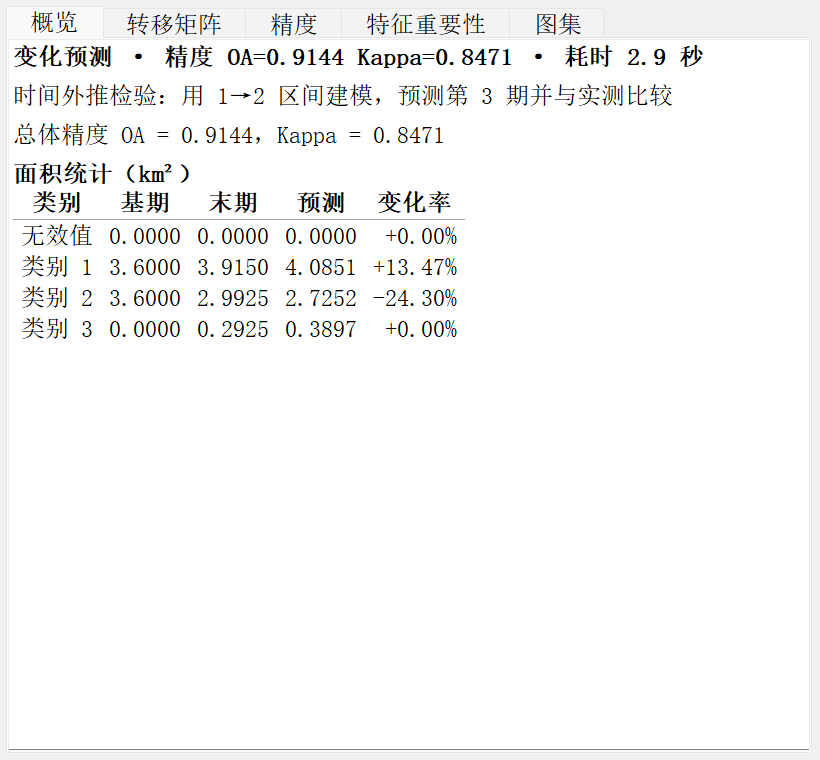

# QGIS CA-Markov 插件

把 [SharpGIS](https://github.com/LQC20504-collab/SharpGIS) 的 CA-Markov 土地利用变化预测引擎
包装成 QGIS 处理工具箱里的三个算法。引擎以**子进程**方式运行，用独立的 Python 解释器，
不占用 QGIS 进程，因此不会与 QGIS 自带的 GDAL 冲突。

## 三个算法

| 算法 id | 名称 | 用途 |
|---|---|---|
| `camarkov:analyze` | 转移分析 | 秒级，只算转移矩阵与面积统计，不写栅格。调参前先跑它 |
| `camarkov:train` | 训练模型 | 训练 81 类转移潜力的随机森林，输出可复用的 `.npz` |
| `camarkov:predict` | 变化预测 | 完整链路：栅格 + 报告 + 图表 + 指标 JSON |

## 界面



结果面板是**非模态停靠窗口**（不是对话框），可与图层面板并存，不遮挡画布。
五个页签：概览 / 转移矩阵 / 精度 / 特征重要性 / 图集。

## 依赖

- QGIS 3.28 及以上（在 3.40.15 LTR 上验证）
- Python 依赖：`numpy scipy scikit-learn rasterio matplotlib`

插件优先使用 **QGIS 自带的 Python**（`<QGIS>/apps/Python3xx/python.exe`）。
在 QGIS 3.40.15 LTR 上这五个包通常已经齐全，无需额外安装。
若缺少，算法会直接给出可复制执行的 `pip install` 命令。

探测顺序：上次选定 → `CAMARKOV_PYTHON` 环境变量 → QGIS 自带 → conda/系统路径 → `PATH`。

## 安装

> ### ⚠️ 别点仓库首页的绿色 Code 按钮
>
> 那个 **Code → Download ZIP** 下载的是 GitHub 的**源码快照**，压缩包顶层目录叫
> `qgis-camarkov-master/`（GitHub 用「仓库名-分支」命名归档），真正的插件包还在里面一层。
>
> QGIS 的 ZIP 安装会把最短的 `metadata.txt` 所在**目录**当作插件名去 `import`，
> 于是拿到 `qgis-camarkov-master/qgis_camarkov` —— 既含斜杠又含连字符，必然失败：
>
> ```
> ModuleNotFoundError: No module named 'qgis-camarkov-master/qgis_camarkov'
> ```
>
> **要装的是 Releases 里的 `qgis_camarkov-<版本>.zip`**，它的顶层只有一个 `qgis_camarkov/`。

### 从 ZIP 安装（推荐）

1. 打开 **Releases** 页面 → 展开对应版本的 **Assets**（不要点 Code）
2. 下载 `qgis_camarkov-0.1.0.zip`
3. QGIS → 插件 → 管理并安装插件 → **从 ZIP 安装** → 选这个文件
4. 在「已安装」里勾选「CA-Markov 土地利用变化预测」
5. 重启 QGIS；处理工具箱里应出现 **CA-Markov** 分组下的三项

装完可以自检一遍：

```bash
python scripts/check_install.py
```

它会检查安装位置、`metadata.txt` 能否解析、引擎副本是否在位、插件是否已启用；
装错位置时直接打印出该删哪个目录。

### 开发期（免打包）

```bat
mklink /J "%APPDATA%\QGIS\QGIS3\profiles\default\python\plugins\qgis_camarkov" ^
        "D:\Develop\qgis-camarkov\qgis_camarkov"
```

改代码后在「插件管理器」里点「重载插件」即可，不必重新打包。

## 使用要点

1. **各期栅格必须同网格、同坐标系**。引擎不做自动重采样，程序会在开跑前拒绝不一致的输入。
2. **无效值建议取 0**。引擎按最大像元值决定输出类型：≤255 写 `uint8` 并内嵌 256 色
   类别色表（加载后直接按类别着色）；>255 写 `uint16`，**不含色表**，加载后是灰度。
   负值会让输出数值环绕，因此被禁止。
3. **转移矩阵来源**：默认「最近两期平均」。只有两期数据时会自动退化为最近一个区间。
4. **精度评价**默认是**时间外推**（把末期当未知，用更早的区间建模去预测它）。
   只有两期数据时无法外推，会退回同期自检（in-sample），指标偏乐观，报告里会注明。

## 无头使用（`qgis_process`）

```bash
export QGIS_PLUGINPATH="D:\\Develop\\qgis-camarkov"

# 首次需要启用插件（无头模式下插件默认是禁用的）
python scripts/enable_plugin.py        # 或用 QGIS 自带的 python-qgis-ltr.bat 跑

qgis_process list --json | grep camarkov        # 三个算法应可见
qgis_process run camarkov:predict - <<'JSON'
{"inputs": {
  "PERIODS": ["2010.tif", "2015.tif", "2020.tif"],
  "OUTPUT_RASTER": "pred.tif",
  "OUTPUT_METRICS": "metrics.json",
  "OUTPUT_FIG_DIR": "figs"
}}
JSON
```

矩阵类参数（`FACTORS`、`CLASS_NAMES`）只能用 stdin JSON 传，命令行 `--FACTORS=` 不会自动拆行。

## 开发

```bash
pytest -m "not qgis"     # 纯逻辑 + 引擎端到端，不需要 QGIS
pytest -m qgis           # 通过 qgis_process 跑集成测试，需要本机 QGIS
python scripts/sync_engine.py --from D:\Develop\SharpGIS\Engine   # 同步引擎
python scripts/build_zip.py                                      # 打包
```

引擎在 `qgis_camarkov/resources/engine/` 是 **vendored 副本**，不要在本地改它：
改动提到 SharpGIS 上游，再用 `scripts/sync_engine.py` 同步过来。

## 故障排查

**`ModuleNotFoundError: No module named 'qgis-camarkov-master/qgis_camarkov'`**

装的是源码包。删掉多余的一层，改用 Release 附件：

```bat
rmdir /S /Q "%APPDATA%\QGIS\QGIS3\profiles\default\python\plugins\qgis-camarkov-master"
```

然后按上面「从 ZIP 安装」重装 `qgis_camarkov-0.1.0.zip`。

**插件管理器里显示「已安装」但处理工具箱没有 CA-Markov**

先跑 `python scripts/check_install.py`。常见原因：
`metadata.txt` 里出现了 `%`（configparser 插值失败）、或插件在 `QGIS3.ini` 里被禁用
（`python scripts/enable_plugin.py` 可修复）。

**`qgis_process list` 看不到 `camarkov:*`**

无头模式下插件默认不加载。先 `python scripts/enable_plugin.py`，
再确认 `QGIS_PLUGINPATH` 没指到别的目录。另外从 conda 里启动 `qgis_process` 时，
务必清掉 `PYTHONHOME` / `PYTHONPATH` —— 它们指向 conda 的 stdlib，与 QGIS 自带解释器
混用会让 QGIS 直接以 `0xC0000409` 崩溃（没有 traceback，只有退出码）。

**报「找不到可用的 Python 解释器」或缺少依赖**

插件优先用 QGIS 自带的 Python。若它缺包，错误信息里会给出可直接复制执行的
`pip install` 命令；也可以设 `CAMARKOV_PYTHON` 环境变量指向自己的 conda 环境。

## 许可证

本仓库整体为 GPL-2.0-or-later；`qgis_camarkov/resources/engine/` 下的两个引擎文件
来自 SharpGIS，继续以 MIT 授权（见该目录的 LICENSE）。详见根目录 `LICENSE`。
